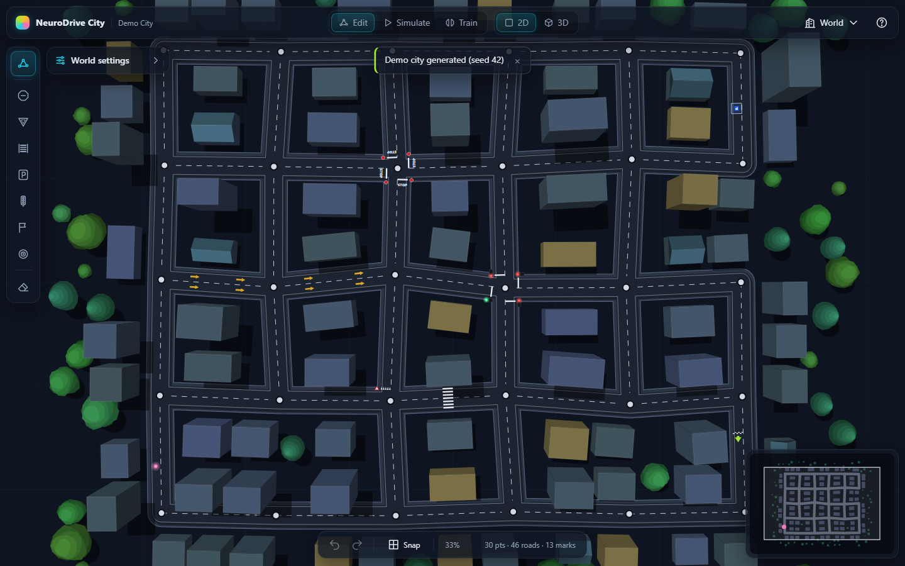
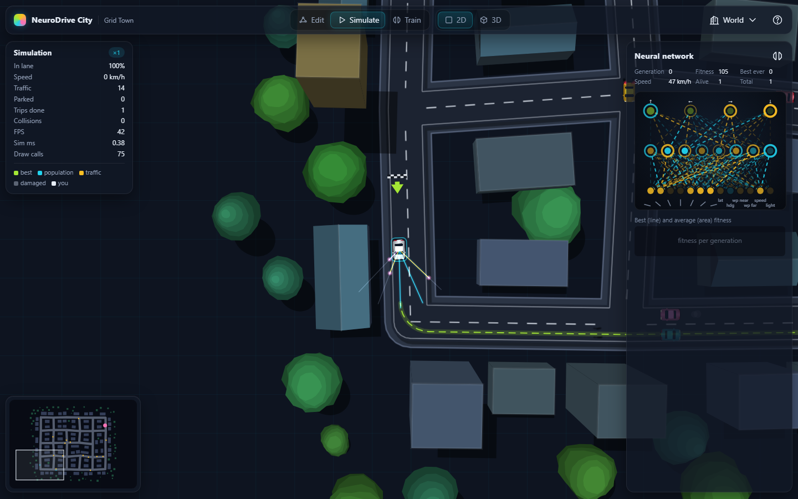
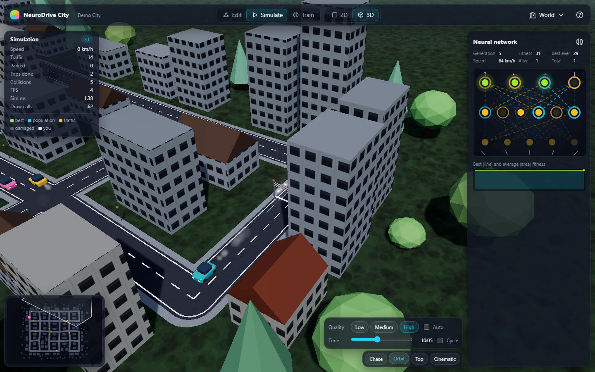
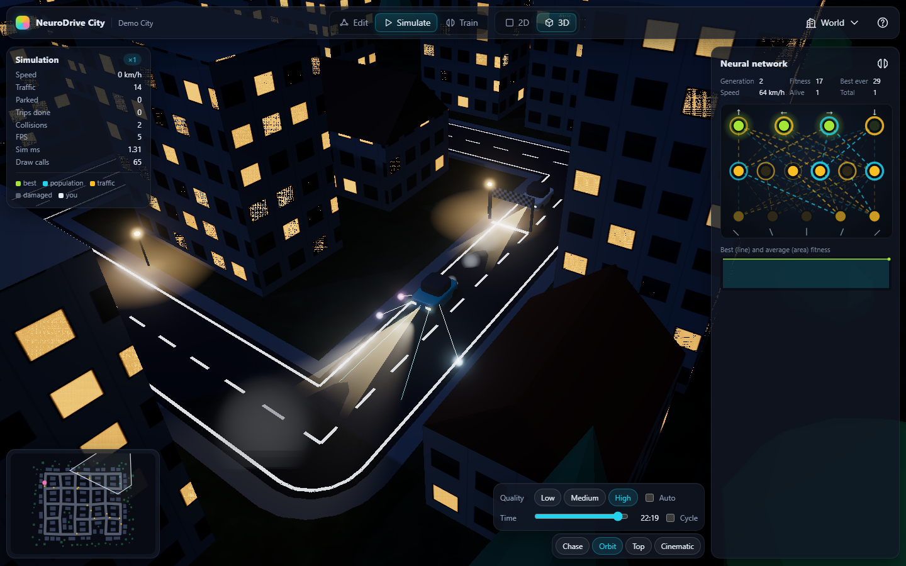
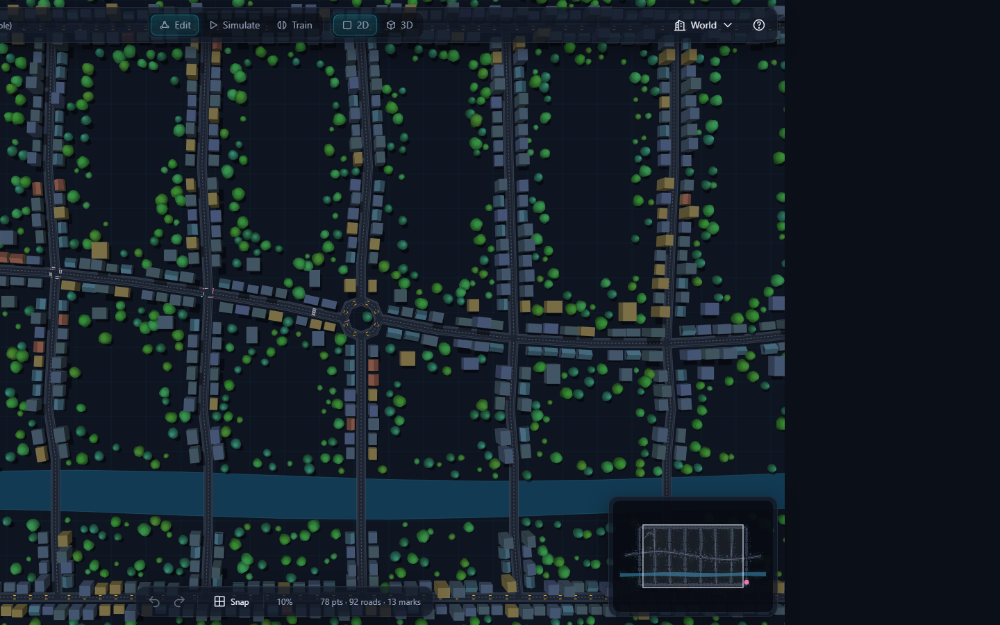
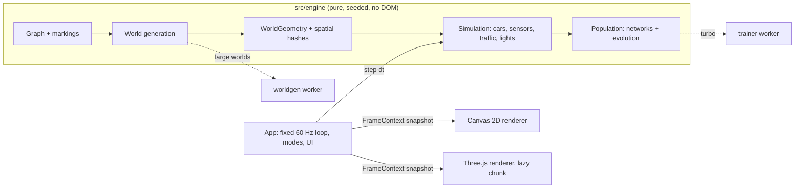
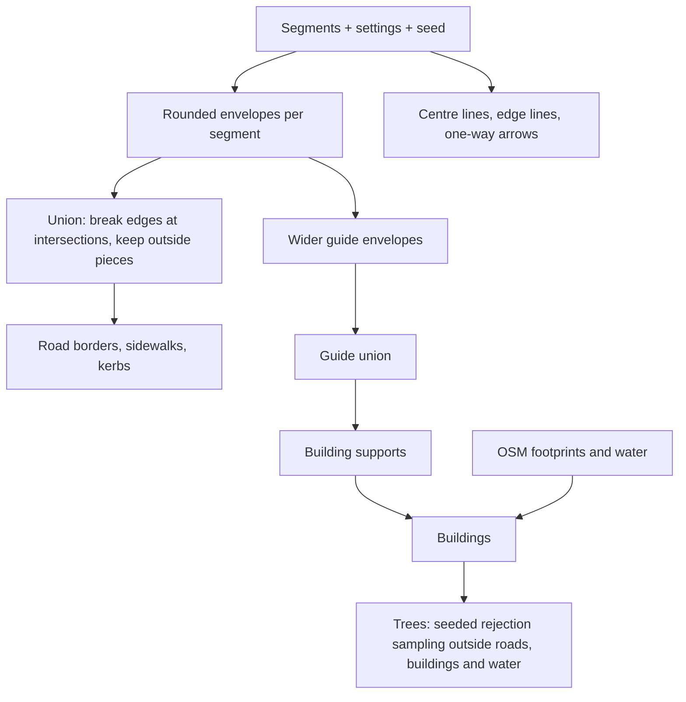
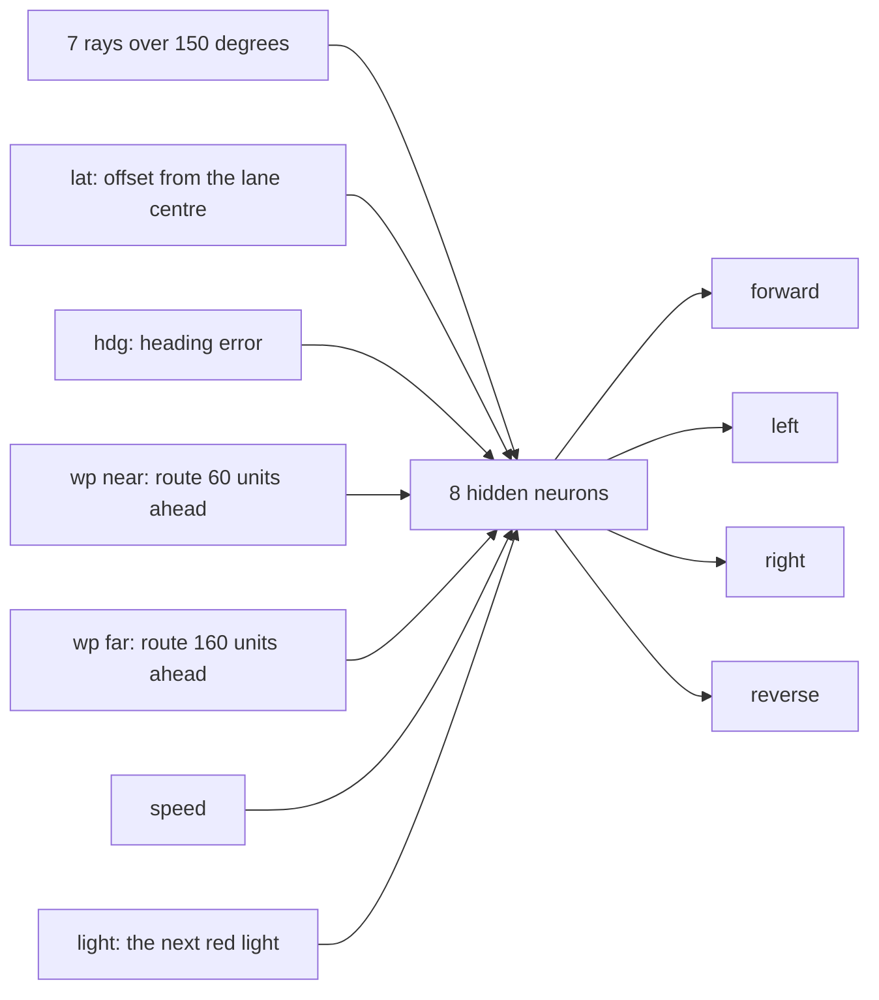
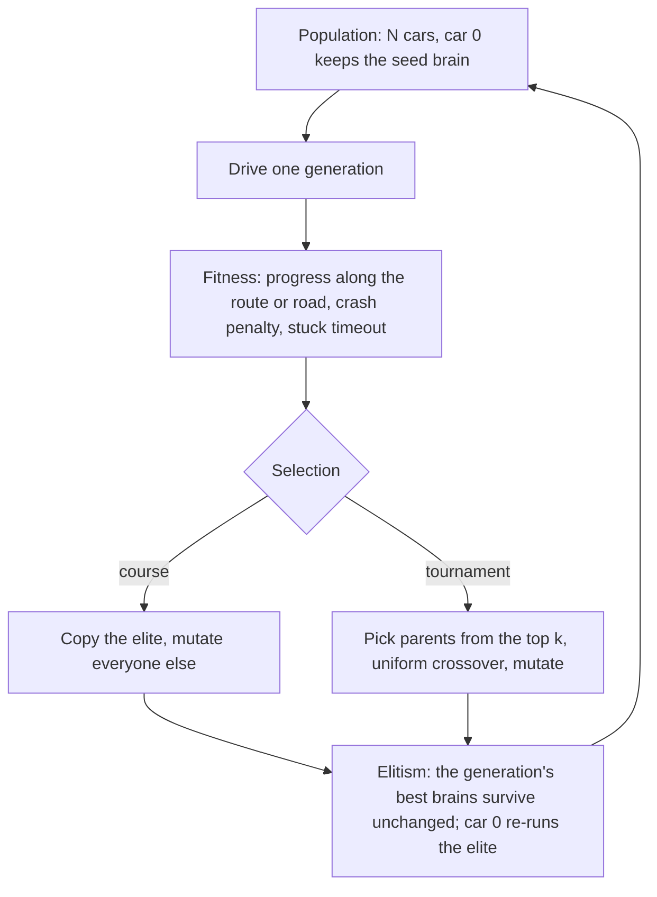
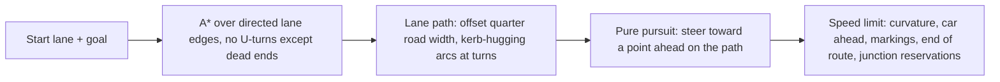

# NeuroDrive City

**Build a city, drop in traffic, and watch self-driving cars learn to drive it.** An editable
virtual city in TypeScript where cars learn with a from-scratch neural network and
neuro-evolution, shown in a crisp 2D editor and a lit, bloomed 3D view.

**Live demo:** [neurodrive-city.pages.dev](https://neurodrive-city.pages.dev/) (Cloudflare Pages)

| Editor (2D)                              | Simulate (2D)                         |
| ---------------------------------------- | ------------------------------------- |
|    |  |
| **3D by day**                            | **3D at night**                       |
|      |  |



More screenshots: [training in Grid Town](docs/media/train-2d.png),
[the city brain driving the route](docs/media/sim-city.png),
[route training with the curriculum](docs/media/train-city.png),
[the OSM sample town in 3D](docs/media/osm-3d.png), [the infinite road](docs/media/infinite-road.png)
and [the first-run tour](docs/media/tour.png). All of them are written by the Playwright specs.

## Features

### World editor
- Click to add road points, drag to move them, Shift+drag to box-select, Alt+click to split a
  segment, right-click to delete, `O` to make segments one-way. Every edit is undoable (200 steps).
- Zoom eases toward the cursor, pan with the middle or right button, Space+drag or one finger;
  pinch zoom on touch screens. Grid snapping and point snapping with a visible snap pulse.
- Markings snap onto roads and stay bound to their segment: stop, yield, zebra crossing, parking
  bay, traffic light, start and target. Splitting a road re-binds its markings and deleting a road
  removes them, so a marking is never orphaned.
- Worlds autosave to IndexedDB, live in a world library with minimap thumbnails, and save or load
  as small `.world.json` files (graph, markings, settings and seed only). No page reloads, ever.

### Procedural city
- Roads are the union of rounded envelopes around every segment, with sidewalks, kerbs, dashed
  centre lines, solid edges and one-way arrows.
- Buildings line the streets on guide envelopes, trees fill the gaps by seeded rejection sampling;
  the same seed always gives the same city.
- Large worlds regenerate in a Web Worker with a progress bar; dragging shows a cheap preview and
  the city catches up when you let go.
- OpenStreetMap import: paste Overpass JSON (a sample query and a bundled fictional sample town are
  included). Drivable highways only, correct `oneway` handling, bridges and tunnels, and imported
  building footprints and water that replace procedural buildings and keep trees out of rivers.

### Traffic and navigation
- Car physics with friction and a speed cap, five ray sensors, polygon damage against borders,
  buildings, trees and other cars.
- Traffic cars pick random destinations and drive there with lane-level A* (no U-turns except at
  dead ends) and pure-pursuit steering, slowing for curves, cars ahead, stop signs, yield signs,
  zebra crossings and red lights; junction reservations keep all-way stops from deadlocking.
- Traffic lights cycle green, yellow and an all-red gap per junction, with fading lamps.

### Neural network and evolution
- A fully-connected network written from scratch (step or tanh activation). On the infinite road
  the course homage [5, 6, 4]: five rays in, forward / left / right / reverse out. In cities
  [13, 8, 4] with tanh: seven rays plus six route inputs (offset from the lane centre, heading
  error, two waypoints ahead, speed, the next red light), so the cars learn to follow a route in
  their own lane and stop for red lights.
- Hundreds of AI cars evolve at once: course-style selection (one elite) or tournament selection
  with uniform crossover and three elites, stuck detection, seeded generations that replay identical
  traffic, and per-generation best and average fitness in a sparkline.
- Lane-discipline fitness in cities: progress counts only in the right-hand lane, and more than a
  second over the centre line eliminates a car. A route curriculum starts with the first straight
  and grows the route corner by corner; the HUD shows "In lane" and the route preview turns green,
  amber or red with the focused car's lane position.
- A live network visualizer shows the focused car's brain firing, with hover explanations.
- Turbo training runs evolution in a Web Worker at full CPU speed and hands back the best brain.
- Two pre-trained brains ship in `public/brains/`, both trained with the app's own headless
  trainer: a highway brain for the infinite road and a city brain that drives Grid Town's route
  (it drives the Simulate demo car and seeds city training).
- The classic infinite road (straight or curvy) as a training mode.

### 3D renderer
- Loaded on demand (Three.js stays out of the initial bundle) with a crossfade from 2D.
- Instanced buildings with a window facade shader, wind-swayed instanced trees, five draw calls for
  up to 1100 cars, a detailed focused car with spinning, steering wheels.
- Chase, orbit, top and cinematic cameras with eased 750 ms blends; click a car to follow it.
- Day and night from one time-of-day value: shader sky with stars, sun shadows that follow the
  camera, lit windows, street lights, traffic lamps, headlight cones; bloom on everything emissive.
- Low / Medium / High quality presets with automatic downgrade when frames get slow.

## How it works

### Engine and renderers

The engine (`src/engine`) is pure TypeScript with no DOM, Canvas or Three.js imports and no
`Math.random` (both enforced by ESLint and a DOM-free tsconfig), so the same code runs in the
browser, in Web Workers, in Vitest and under plain Node (`npm run train`).



The loop runs the simulation at a fixed 1/60 s step (the speed multiplier changes steps per frame,
never `dt`) and renderers interpolate poses between steps. Renderers only read a per-frame
snapshot; they never mutate engine state.

### World generation



The union never mutates its inputs, uses bounding-box prefilters and a spatial hash, and drops
zero-length pieces. Every random choice comes from a seeded mulberry32 generator, so a world is
fully described by its graph, settings and seed.

### Neural network forward pass



That is the city network ([13, 8, 4], tanh); the infinite road keeps the course's five rays and
six hidden neurons. Each level computes `sum = Σ input × weight`, then the step activation fires when `sum > bias`
(the course's binary controls) or tanh gives proportional outputs. A ray reading is
`1 − distance / length` of its nearest hit, so 0 means clear and values near 1 mean an obstacle
is close.

### Evolution loop



Mutation moves every weight and bias toward a fresh random value by `amount` (0 is the identity,
1 is fully random). Each generation replays the same traffic and light phases, so generations
are compared fairly; the elite re-runs every generation, so in a world without spawn jitter it
reproduces its score and the best never gets worse.

### Routing: A* plus pure pursuit



## Beyond the course

The two freeCodeCamp courses this project grew out of end with a working but deliberately simple
build. [COMPARISON.md](COMPARISON.md) lists every limit of that build, what this project does
instead, and the test or file that proves it. In short:

- Markings change behaviour (stop, yield, crossings, parking, lights, targets), each tested.
- Cars find routes with lane-level A* and follow them with pure pursuit; traffic fills the city.
- Editing has undo, selection, splitting, box select, shortcuts, touch and cursor-anchored zoom.
- Regeneration is incremental, version-counted and off the main thread for large worlds.
- Geometry is exact (no fixed ray origins, no midpoint containment, no mutating unions), and
  everything random is seeded.
- Saves are graph plus seed (kilobytes, not megabytes) in IndexedDB, with a world library.
- Evolution has generations without reloads, crossover, elitism, stuck detection, a sparkline,
  turbo training and a validated pre-trained brain.
- Rendering uses spatial hashes, cached layers, frustum culling and instancing, with measured
  budgets.
- The code is strict TypeScript with unit tests, end-to-end tests, lint and CI.

## AI navigation

In a city with a Start and a Target, AI cars learn to drive the lane route between them, in the
right-hand lane, to stop for red lights and to stop at the Target. A pre-trained city brain does
this out of the box: it drives the Simulate demo car and seeds Train mode in city worlds.

**What the network sees.** Seven rays over 150° reaching 200 units, plus six route inputs
measured against the lane path: `lat` (signed offset from the lane centre, ±1 at a quarter road
width; negative is toward oncoming traffic), `hdg` (heading error against the lane, ±1 at 90°),
`wp near` and `wp far` (signed angles to the lane 60 and 160 units ahead), `speed`, and (since
v1.2) `light`, the proximity of the next red or yellow traffic light on the route (1 at the stop
line, 0 at 250 units or when it is green). Topology [13, 8, 4], tanh.

**What it is rewarded for.** Progress along the route, credited per step by how well the car keeps
its lane: full credit within 0.15 road widths of the lane centre, falling to a quarter at 0.35 and
nothing beyond. More than one second with the car's centre over the centre line, or crossing a
stop line on red, eliminates the car (and costs 20% of its fitness, like a crash); driving the
wrong way earns nothing; reaching the end of the route adds its length again and freezes the car
there. Waiting is not being stuck: a car standing behind another car or at a red light keeps its
place. During training the 300 learners are ghosts that traffic does not see, so a ghost only
crashes when it drives into something, not when traffic drives into it.

**How it learns corners.** Every car starts at the one Start, so no car sees a corner until the
straight is solved. The curriculum evaluates only the first 320 units of the route, then 260 more
whenever 10% of the cars (or the best car twice in a row) reach the end, so the population solves
the straight, then each corner in turn. Spawn positions jitter by ±8% of a road width and ±4°, so
no brain can memorise one exact trajectory. The training panel shows "Stage k · route x%".

**The bundled city brain** (`public/brains/city.brain.json`, [13, 8, 4] tanh) was trained in Grid
Town with `npm run train:city -- --seed 11 --mutation 0 --vary-traffic --until 4 --broad-until 10`:
300 cars, 120 generations, 444 s on one CPU core, with Train mode's 5 s stuck timeout and 60 s
generations and a new traffic pattern every generation. It covered the whole 555 m route (5548
units, nine corners, a signalised junction and an all-way stop) at generation 87. Validation
drives one exact copy alone among 14 traffic cars:

| Check | Result |
| ----- | ------ |
| 5 validation seeds (the bar: 3 of 5 reach the Target with no crash and at least 95% in lane) | 4 of 5 passed: arrived in 75.6 to 76.5 s (it waits at the red light) with 99.0 to 99.7% of the time in lane; the fifth crashed into traffic at 42% of the route |
| 20 unseen traffic seeds | 9 reached the Target cleanly; 11 crashed; no lane violations and no red lights run; 99.9% of the time in lane and 71% of the route on average |
| Simulate mode for 5 minutes (traffic never resets) | Arrived on 2 of 5 laps; never more than 12.3 units left of the lane centre (the centre line is 25 units away) |

The lane discipline is solid, every corner is taken and the car stops for red lights. Traffic is
still the weak point: of the 11 crashes on unseen traffic, 5 end against the back of a queue, 4 in
junction conflicts with oncoming or crossing traffic and 2 against the kerb.

**What it took** (seeded runs, 300 cars; details in [PROGRESS.md](PROGRESS.md)):

| Setup | Result in Grid Town |
| ----- | ------------------- |
| v1.0: rays plus waypoint angle and speed, progress within 0.45 road widths | stopped at the first corner (at most 28% of the route) |
| v1.1 inputs and fitness, tournament selection, best-ever elite | braked for the first left turn but never steered left |
| course selection | reached the second left turn, then stalled for 100+ generations: the elite's score from the previous curriculum stage could not be beaten |
| elite re-evaluated every generation, its bar reset per stage | with mutation 0.05 to 0.12 still stuck at the first corner (8 seeds for 150 to 250 generations, and 2 more runs in v1.2); crossover alone (mutation 0) reached the Target in about 100 |
| one replayed traffic pattern | 98% in lane, but 1 of 20 unseen traffic seeds passed (it rear-ended stopped traffic) |
| v1.1: a new traffic pattern every generation, 30 s waits | 5 of 20; traffic hit the waiting ghosts from behind, and the network could not see lights |
| v1.2: ghosts only crash into things, a light input, the red-light rule, waits are not stuck | the shipped brain: 9 of 20, no red lights run (3 of 11 runs reached the whole route; the best of them shipped) |

Train mode keeps the spec's city defaults (tournament selection, mutation 0.12, 5 s stuck timeout,
60 s generations); the headless trainer's settings above are training choices, recorded in
[DECISIONS.md](DECISIONS.md) (#101 to #112). For comparison, the scripted route follower that drives
the traffic scores 100% in lane on the same route and arrives in 43.9 s.

## Controls

| Keys                        | Action                                        |
| --------------------------- | --------------------------------------------- |
| `1` to `8`, `E`             | Road tool, marking tools, erase               |
| Click / drag / right-click  | Add or select / move / delete                 |
| `Shift`+drag, `Alt`+click   | Box select, split a segment                   |
| `Delete`, `O`, `G`          | Delete selection, toggle one-way, grid snap   |
| `Ctrl+Z`, `Ctrl+Shift+Z`    | Undo, redo                                    |
| Wheel, middle/right drag    | Zoom toward the cursor, pan                   |
| `Tab`, `T`                  | Edit or Simulate, Train                       |
| Arrows / `WASD`, `R`        | Drive your car, reset it                      |
| `Space`, `+` / `-`          | Pause, simulation speed                       |
| `S`, `X`                    | Save best brain, discard it                   |
| `V`, `C`, `L`               | 2D or 3D, cycle camera, day or night          |
| `F`, `B`, `N`, `M`          | Follow the AI car, all rays, network panel, minimap |
| `Ctrl+S`, `Ctrl+O`, `?`     | Save world, open world, all shortcuts         |

## Tech stack and why

| Choice | Why |
| ------ | --- |
| TypeScript 6 (strict, `noUncheckedIndexedAccess`, `exactOptionalPropertyTypes`) | The engine is numeric code where an `undefined` slipping into a typed array is a silent bug. |
| Vite 8 | Fast dev server, ES module workers, code splitting for the lazy 3D chunk. |
| Three.js (the only runtime dependency) | Mature WebGL renderer with instancing, shadows and post-processing. |
| Canvas 2D | The editor and 2D view need crisp vector drawing and full control over caching. |
| Vitest 5, Playwright 1.65 | Unit tests on the same ES modules; real Chromium (with WebGL) for end-to-end tests. |
| ESLint 10 + typescript-eslint, Prettier | Type-aware linting, including the engine's no-DOM and no-`Math.random` rules. |

## Performance

Budgets from the spec, and what was measured (headless Chromium with software WebGL in CI, so real
GPUs do much better):

| Budget | Measured |
| ------ | -------- |
| Simulation step for 300 cars with 5 rays: at most 4 ms | 1.2 to 2.7 ms (Vitest benchmark, run alone) |
| 2D frame, demo city with traffic | 16.9 ms frame, 1.4 ms render (headless) |
| 2D Train with 300 AI cars plus traffic | 2.8 ms render, 3.1 ms simulation per frame |
| 3D draw calls in the demo city: at most 150 | 77 by day (shadows and bloom on High), 65 at night |
| 3D scene rebuild for the demo city: at most 300 ms | 38 ms |
| GPU memory back to baseline after 3 rebuilds | 32 geometries / 18 textures before and after |
| Initial JS (gzip) without the 3D chunk: at most 200 KB | about 80 KB; the 3D chunk (about 174 KB) loads on demand |
| Dragging a point in a 325-segment world | 16.7 ms average frame |

Hot paths (per car per step and per frame) allocate nothing: vectors, typed arrays, closures and
scratch objects are created once and reused.

## Testing

```bash
npm run test           # Vitest unit tests
npm run test:coverage  # with coverage (engine lines must stay above 80%)
npm run e2e            # Playwright against a production build under /neurodrive-city/
npm run verify         # typecheck, lint, test, build, e2e
```

 _(static badge; refresh it from `npm run test:coverage`)_

At v1.2.0: 280 unit tests in 32 files, engine line coverage 98.4%, and 26 end-to-end specs. The
wall-clock benchmarks run alone after every other test file, so they measure the code rather than
a busy CPU.

End-to-end specs check zero console errors on every page, non-blank canvases (pixel variance), the
editor, saving and loading, OSM import, simulation, training, turbo training, the 3D view by day
and night, draw-call and memory budgets, the onboarding tour, accessible names, keyboard focus and
the 1280×720 layout. Screenshots land in `e2e/__screenshots__/`.

## Deploy

**GitHub Pages:** push to `main`; `.github/workflows/deploy.yml` type-checks, lints, tests, builds
with `VITE_BASE=/<repo-name>/` and publishes `dist/`. In the repository settings, set Pages to
"GitHub Actions" once.

**Cloudflare Pages (the live demo):** `npm run deploy:cf` builds at the site root and uploads
`dist/` to the `neurodrive-city` Pages project with Wrangler (run `npx wrangler login` once).
`public/_headers` gives the content-hashed files in `/assets` a one-year immutable cache. To
deploy from Git instead, connect the repository in the Cloudflare dashboard with build command
`npm run build` and output directory `dist` (the base path defaults to `/`).

**Recording a GIF for the README:** run `npm run dev`, open the demo city, press `T` to train at
×8, then `V` for 3D and `L` for night. Record a 10 to 15 second clip with any screen recorder
(for example ScreenToGif on Windows or Kap on macOS) at 30 fps and about 960 px wide, and save it
as `docs/media/demo.gif`.

## Roadmap

- WebGPU renderer as a third `Renderer` implementation.
- NEAT (evolving topologies) and a reinforcement-learning baseline to compare against.
- Curved (Bezier) roads and per-segment lane counts.
- Pedestrians on zebra crossings.
- AI navigation in traffic: queues and junction conflicts (see the backlog).

## Acknowledgements

Inspired by Radu Mariescu-Istodor's freeCodeCamp courses "Self-Driving Car with JavaScript (No
Libraries)" and "Build a Virtual World Filled with Self-Driving Cars" (repositories
[gniziemazity/self-driving-car](https://github.com/gniziemazity/self-driving-car) and
[gniziemazity/virtual-world](https://github.com/gniziemazity/virtual-world), both MIT licensed).
NeuroDrive City is an independent re-implementation in TypeScript, written from first principles;
no code was copied from those repositories.

## License

MIT, see [LICENSE](LICENSE).
